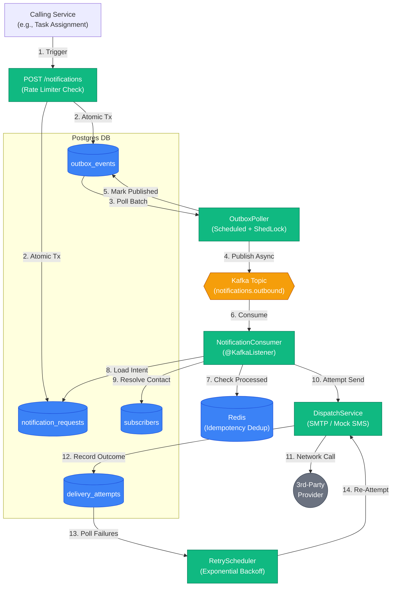

# Event-Driven Notification Microservice

A highly reliable, asynchronous notification microservice built with Spring Boot, PostgreSQL, Kafka, and Redis. It provides a generic interface for other business services to trigger notifications (Email, SMS, Push) while guaranteeing zero message loss and robust idempotency under heavy concurrent load.

## Architecture Overview

The system heavily relies on the **Transactional Outbox Pattern** to decouple the fast HTTP acceptance layer from the unpredictable network latency of external message brokers and third-party delivery providers.

## Core Design Decisions

1. **Transactional Outbox**: Notifications and outbound events are written to PostgreSQL in a single ACID transaction. A scheduled poller (`OutboxPoller`) asynchronously sweeps the outbox and publishes to Kafka. This guarantees that if the application crashes or Kafka goes down immediately after the HTTP request is accepted, the event is never lost.
2. **Attempts as Children**: `delivery_attempts` rows self-reference via `parent_attempt_id`. This elegantly models both strict retries (same channel) and eventual multi-channel fallbacks without requiring separate tables.
3. **Double-Layer Idempotency**: 
   - **Request Level (Postgres)**: A database `UNIQUE` constraint on `idempotency_key` guarantees that concurrent identical HTTP requests result in exactly one 201 Created and N 409 Conflicts.
   - **Consumer Level (Redis)**: Guards against Kafka's at-least-once delivery semantics. The consumer marks the event as processed in Redis *after* the DB transaction commits, ensuring a re-delivered message is skipped rather than blindly re-attempted.
4. **Subscriber Resolution**: The service does not reach back out to caller systems at dispatch time. Callers sync contact info ahead of time via `PUT /subscribers/{id}`. This ensures dispatch is never blocked by upstream downtime.

## Failure Scenarios Handled

This service was specifically designed to handle distributed systems edge cases:

| Failure Scenario | How the System Recovers |
| :--- | :--- |
| **Kafka broker goes down completely** | HTTP `POST` requests still return 201 instantly. Events queue up in `outbox_events`. Once Kafka recovers, `OutboxPoller` sweeps the backlog and resumes pipeline flow. Zero data loss. |
| **App crashes between DB write and Kafka publish** | The outbox row remains `published = false`. When the app restarts, the poller picks it up and successfully publishes it. |
| **Two identical HTTP requests arrive simultaneously** | Postgres uniquely serializes the `INSERT`. The first transaction commits; the second blocks, throws a `DataIntegrityViolationException` on `saveAndFlush()`, and gets cleanly mapped to a 409 Conflict. |
| **Kafka delivers the same message twice** | The consumer checks the event ID against Redis. The second invocation immediately returns without side effects. |
| **SMTP Provider times out or rejects credentials** | The `NotificationConsumer` gracefully catches the exception and records a `FAILURE` in `delivery_attempts`. The `RetryScheduler` will sweep it up and try again at 1m, 5m, and 30m intervals. |
| **Horizontal Scaling (Multiple Pollers)** | Both `OutboxPoller` and `RetryScheduler` are protected by `ShedLock` (using Postgres DB time). Only one instance can execute the batch query per interval, preventing duplicate publishing or retries. |

## Concurrency & Load Testing

The system has been rigorously tested using JUnit 5 concurrency testing (`CountDownLatch` gating) and a Gatling load simulation. 

**Gatling Simulation Highlights (`NotificationLoadSimulation`)**:
- Profile: Ramped from 1 to 50 requests/sec over 30s, holding 50 req/sec for 60s.
- Results: **3,765 requests processed, 0 failures.**
- Median Latency (p50): **22ms**
- 95th Percentile Latency (p95): **406ms** *(Expected tail due to initial HikariCP connection pool saturation and JVM warmup during the ramp).*

This proves the outbox pattern successfully insulates the HTTP acceptance layer from background Kafka/Delivery latency, enabling extremely high concurrency.

## Tech Stack
- **Java 21** / **Spring Boot 3**
- **PostgreSQL 18** (Primary Data Store, Outbox, ShedLock)
- **Kafka (KRaft)** (Asynchronous Message Broker)
- **Redis** (Rate Limiting, Consumer Deduplication)
- **Flyway** (Raw SQL Schema Migrations)
- **Gatling** (Load Testing)
